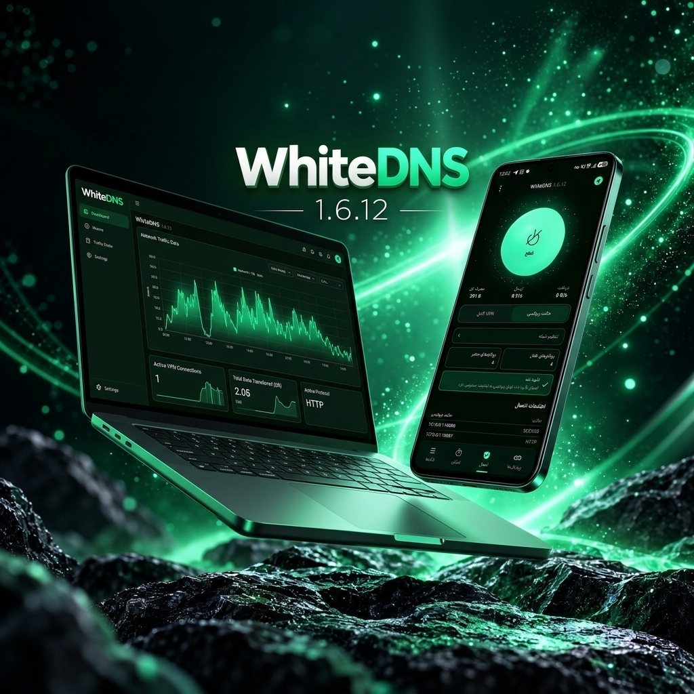
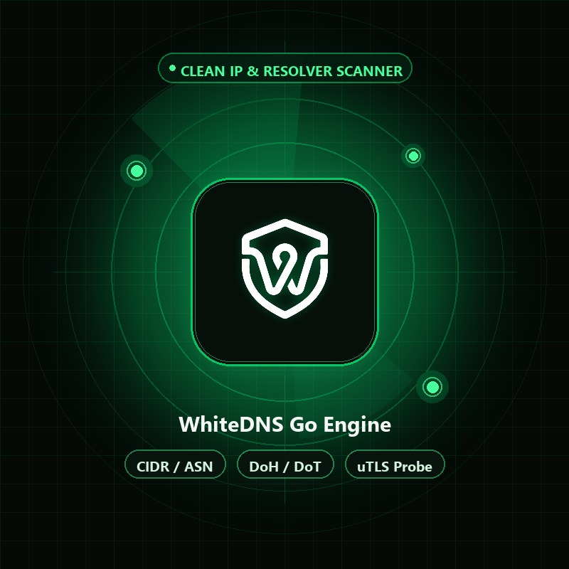
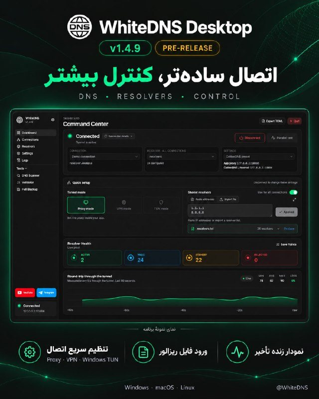
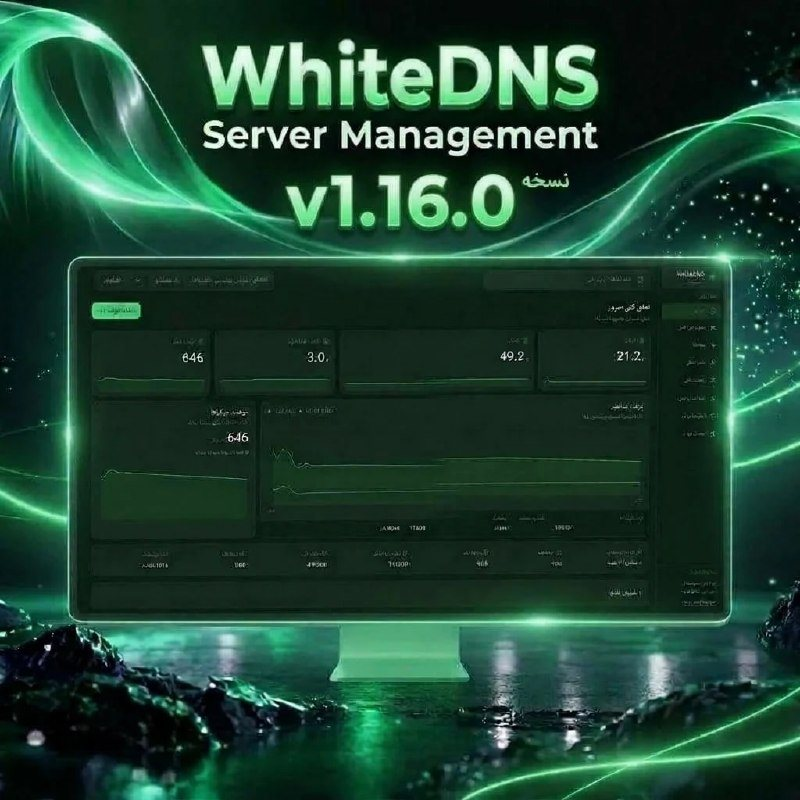

  

<h1 align="center">WhiteDNS</h1>

  <strong>Connectivity tools for an open internet</strong> 
  VPN clients, DNS tunnels, network diagnostics, and self-hosted infrastructure.

  <a href="https://whitedns.online/"><strong>whitedns.online</strong></a>
  &nbsp;·&nbsp;
  <a href="https://whitedns.online/en/">Downloads &amp; guides</a>
  &nbsp;·&nbsp;
  <a href="https://t.me/whitedns"><strong>Telegram @WhiteDNS</strong></a>

## Find the right app

<table align="center">
<tr>
<td align="center" valign="top" width="50%">
  
  
<strong>WhiteVPN</strong>

  
VPN and proxy client with Mihomo, subscriptions, and connection chaining.

  

  
<a href="https://github.com/WhiteDNS/WhiteVPN">Android &amp; TV</a> · <a href="https://github.com/WhiteDNS/WhiteVPN-Desktop">Desktop</a>

</td>
<td align="center" valign="top" width="50%">
  
  
<strong>WhiteAesther</strong>

  
Find reachable connection routes with the Aether engine.

  

  
<a href="https://github.com/WhiteDNS/WhiteAestherMobile">Android</a> · <a href="https://github.com/WhiteDNS/WhiteAesther">Desktop</a>

</td>
</tr>
<tr>
<td align="center" valign="top" width="50%">
  
  
<strong>WhiteDNS</strong>

  
Connect over DNS tunnels when your network is restricted.

  

  
<a href="https://github.com/WhiteDNS/WhiteDNS-Android">Android</a> · <a href="https://github.com/WhiteDNS/WhiteDNS-Desktop">Desktop</a>

</td>
<td align="center" valign="top" width="50%">
  
  
<strong>Clean IP &amp; Resolver Finder</strong>

  
Check which IP addresses and DNS resolvers your network can reach.

  
<a href="https://github.com/WhiteDNS/WhiteDNS-cleanip-finder/releases">Downloads</a> · <a href="https://github.com/WhiteDNS/WhiteDNS-cleanip-finder">Repository</a>

</td>
</tr>
</table>

<strong>See the desktop apps up close</strong>

  
  

## More tools

<table align="center">
<tr>
<td align="center" valign="top" width="50%">
  
  
<strong>CoreForge</strong>

  
VPN and proxy client for iPhone and iPad.

  
<a href="https://whitedns.online/tools/coreforge/">TestFlight guide</a>

</td>
<td align="center" valign="top" width="50%">
  
  
<strong>WhiteGame</strong>

  
Measure ping, jitter, and packet loss for games on Android.

  
<a href="https://whitedns.online/tools/whitegame/">Downloads &amp; guide</a>

</td>
</tr>
</table>

## Self-hosted infrastructure

<table>
<tr>
<td valign="middle">
  
</td>
<td valign="middle">
  
<strong><a href="https://github.com/WhiteDNS/Soar-Server">WhiteDNS Panel / Soar Server</a></strong> Deploy Soar on a Linux VPS and manage accounts, quotas, and subscriptions.

  
<strong><a href="https://github.com/WhiteDNS/WhiteDNS-Wizard">WhiteDNS Wizard</a></strong> Provision a self-hosted 3x-ui/Xray stack with a guided terminal interface.

</td>
</tr>
</table>

## Updates and contributions

Follow [@WhiteDNS on Telegram](https://t.me/whitedns) or read the [web feed](https://whitedns.online/en/feed/) for release announcements and service updates. To report a bug, open an issue in the relevant repository with the app version, your operating system, and steps to reproduce it.

[Explore all WhiteDNS repositories](https://github.com/orgs/WhiteDNS/repositories)

<h2>راهنمای فارسی</h2>

برای اتصال روزمره و مدیریت اشتراک، WhiteVPN را ببینید. اگر پروفایل تونل دی‌ان‌اس دارید، WhiteDNS را برای دستگاهتان دانلود کنید. برای مقایسهٔ برنامه‌ها، از راهنمای انتخاب ابزار شروع کنید.

<a href="https://whitedns.online/choose/">راهنمای انتخاب ابزار</a> · <a href="https://whitedns.online/">دانلود و آموزش فارسی</a> · <a href="https://t.me/whitedns">کانال رسمی تلگرام</a>

